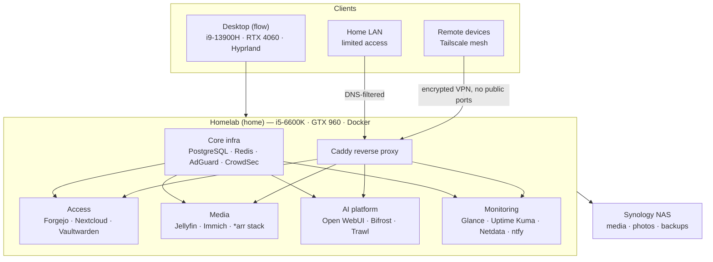
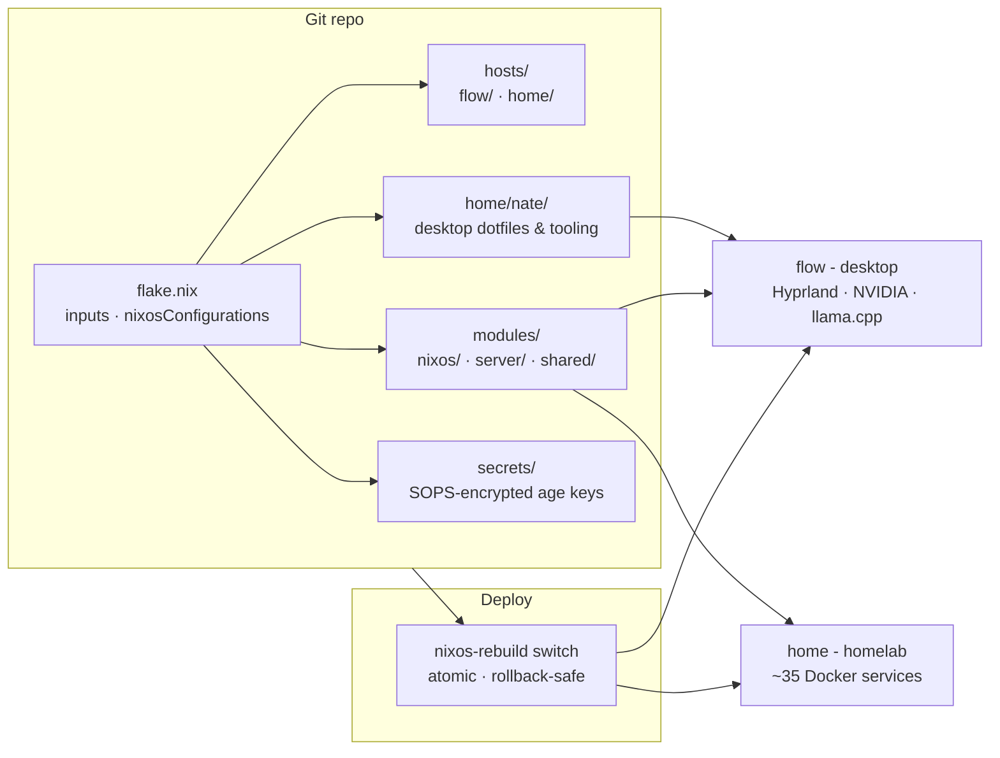
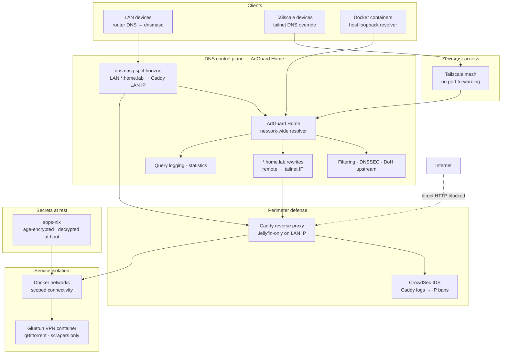

# NixOS Homelab Configuration

Declarative, version-controlled infrastructure for a two-machine NixOS setup: a homelab server and a Hyprland desktop, managed from a single flake.

## What this is

A real self-hosted platform with around 35 services across two machines, the homelab server (Intel i5-6600K, NVIDIA GTX 960) and the desktop (Intel i9-13900H, NVIDIA RTX 4060). Everything is configured declaratively with Nix. A bad change means booting the previous generation, not hours of manual recovery.

The desktop side is the interesting one from a systems standpoint. It is an ASUS ROG Flow X16 laptop with the GPU locked to 55W by firmware, an Intel iGPU, a mini-LED panel, and a Corne split keyboard. Getting all of that to behave under Linux took real debugging, and most of it lives in `hosts/nixos/default.nix` plus the `modules/nixos/` tree.

## Why NixOS

The previous setup was Debian with Docker Compose. Config drift crept in as packages accumulated and manual patches stacked up, and neither machine could be reproduced from scratch. NixOS solved that. Every package, service, and setting is declared in version-controlled Nix files. Atomic upgrades, rollbacks, and one source of truth for two machines.

## Architecture

### System architecture

### Configuration structure

Two NixOS hosts (`flow`, `home`) and one home-manager profile, all driven from a single flake:

### Services

Infrastructure: PostgreSQL 16, Redis, AdGuard Home, CrowdSec, Docker. Core platform services, databases, DNS filtering, and intrusion detection.

Access: Caddy, Forgejo, Nextcloud, Collabora, Vaultwarden. Reverse proxy, self-hosted Git, cloud storage, and a password manager.

AI: Bifrost, Open WebUI, crawl4ai, SearXNG, DeGoog, Trawl, Excalidraw, Whisper, Brightspace MCP, Campus. LLM gateway, web UI for models, web scraping, search, document tooling, an MCP server for the Brightspace LMS, and a personal study-sync agent harness.

Media: Jellyfin, the *arr stack (Sonarr, Radarr, Lidarr, Prowlarr), Immich. Media streaming, automated media management, and a photo library.

Monitoring: Glance, Uptime Kuma, Netdata, ntfy. Dashboards, uptime monitoring, system metrics, and push notifications.

PDF pipeline: pdf-extractor, pdf-ocr, pdf-parse, bentopdf. Document parsing, local OCR, and a Cohere-Parse-compatible service built from source in the repo.

### Security

AdGuard Home is the security control plane, not just an ad blocker. Every LAN, Tailscale, and Docker client resolves through it. It filters malicious and tracker domains, validates DNSSEC, and sends upstream queries over DoH. DNS rewrites for `*.home.lab` replace Authelia SSO: remote clients only reach services when Tailscale is connected and AdGuard returns the tailnet IP. On the LAN, dnsmasq provides split-horizon answers so `*.home.lab` resolves to Caddy's LAN address while everything else still flows through AdGuard for filtering. CrowdSec handles HTTP-layer intrusion prevention; Gluetun isolates torrent and scraper egress.

## Custom tools

Trawl. A web scraping and search API built on crawl4ai and SearXNG. It returns clean markdown from any URL, runs web search across multiple backends, and discovers links. It powers the agent's ability to read and process web content.

## Notable challenges

GPU power cap. The RTX 4060 was locked to 55W by ASUS firmware, well below its rated wattage. NVIDIA's own `nvidia-powerd` was blocked by the SBIOS unless the thermal policy was set to Performance before it initialized. The fix was a chain of boot services that write the ASUS EC power values (dynamic boost budget, CPU package limits) before `nvidia-powerd` starts, plus tuning the RAPL MMIO power domain directly and declaring the values in `asusd.ron`. The GPU now holds around 87W under load.

Platform profile switching. A 15-second timer watches the ACPI platform profile and switches the display between 60Hz on battery and 240Hz on AC, syncs TLP power source, and corrects CPU limits that leak in when the quiet profile flips. It is change-gated so an unchanged tick exits in about a millisecond instead of running a full pipeline every loop, which mattered because the old unconditional poll kept the CPU out of deep sleep states.

## Hardware

Homelab: server, Intel i5-6600K, NVIDIA GTX 960 (2GB), 16GB RAM, 225GB NVMe, NixOS 26.05.

Flow: desktop, Intel i9-13900H, NVIDIA RTX 4060 (8GB), 32GB RAM, 1TB NVMe, NixOS 26.05.

## Getting started

This is a personal infrastructure configuration, not a turnkey project. It is documented for reference and learning. Adapting it to your own hardware and services requires understanding NixOS modules and flakes.

1. Clone the repository.
2. Review `hosts/<name>/default.nix` for host-specific configuration.
3. Generate your hardware configuration with `nixos-generate-config --show-hardware-config`.
4. Adjust `modules/server/` for your service requirements.
5. Set up sops-nix for secret management.
6. Rebuild with `sudo nixos-rebuild switch --flake .#<hostname>`.

## Tech stack

Platform: NixOS, Nix flakes, Docker, systemd.
Networking: Tailscale (mesh VPN), Caddy (reverse proxy), AdGuard Home (DNS), CrowdSec (IDS).
Databases: PostgreSQL 16, Redis.
AI and ML: Bifrost (LLM gateway), Open WebUI, crawl4ai, SearXNG, Playwright.
Media: Jellyfin, Immich, Sonarr, Radarr, Lidarr, Prowlarr.
Monitoring: Glance, Uptime Kuma, Netdata, ntfy.
Secrets: sops-nix (age encryption).
Languages: Nix, Python, Bash.

## License

MIT
