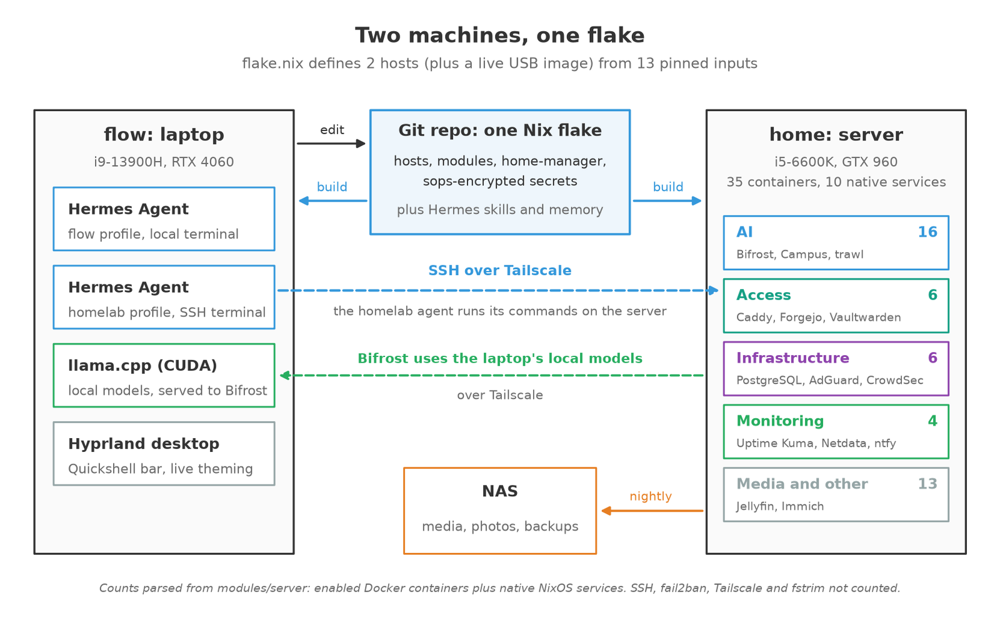
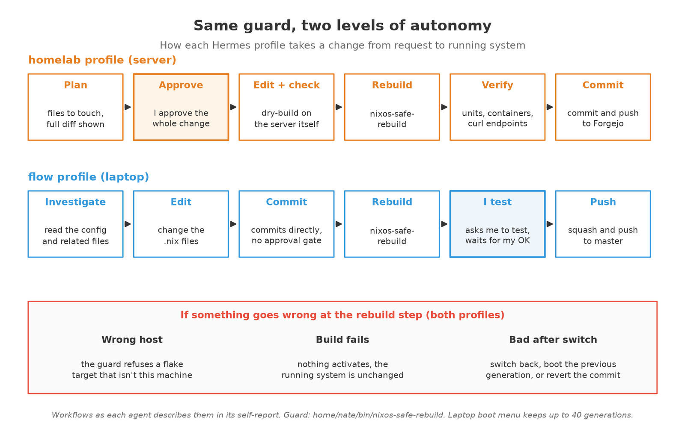
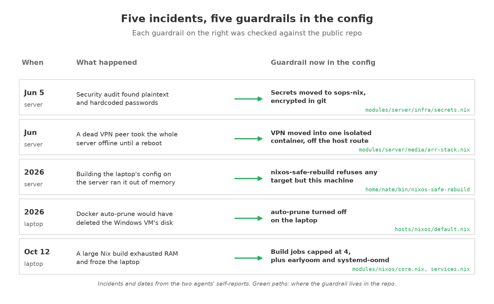
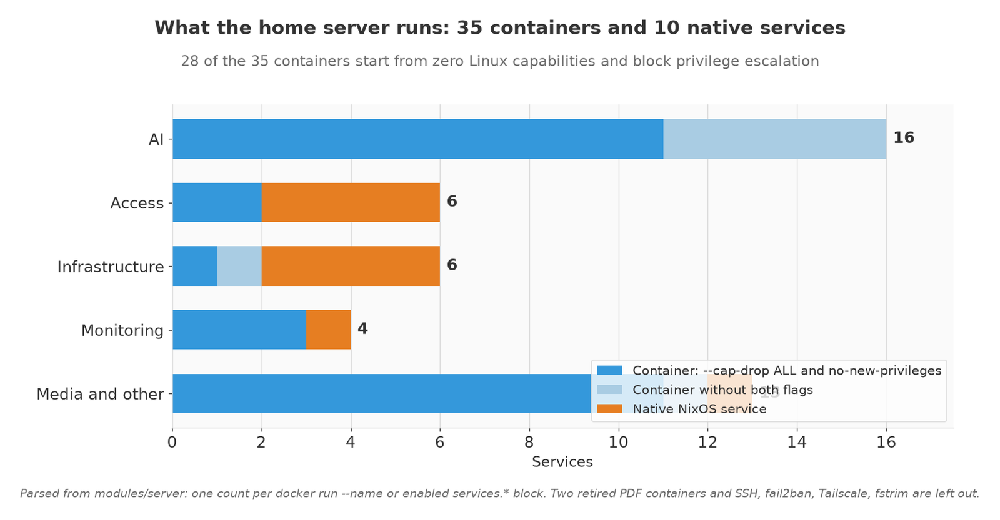

# nixos-config

One Nix flake for my two machines: an ASUS ROG Flow X16 laptop (`flow`) and a home server built from used parts (`home`). It also builds a live USB image. Each machine has its own [Hermes Agent](https://github.com/NousResearch/hermes-agent) profile that makes changes the same way I do: by editing this config and rebuilding.

Full write-up: [nathanespejo.com/projects/homelab](https://www.nathanespejo.com/projects/homelab)



## Why NixOS

I used to run Debian with Docker Compose. Manual fixes piled up and neither machine could be rebuilt from scratch.

With NixOS every package, service, user and firewall rule is declared in version-controlled files, and a rebuild turns them into the running system. That makes it a good surface for an AI agent:

- An agent's change is a git diff I can read before it applies.
- A failed build never activates, so a broken edit leaves the running system alone.
- Every switch is a new generation, so a bad change rolls back in one step.

## How the agents change the system



There are two Hermes profiles, one per machine. Both run on the laptop; the server profile reaches the server over SSH. The two profiles never interact.

They get different autonomy on purpose:

- **Server (`homelab`).** It plans the change, shows me the full diff and waits for my approval. After the rebuild it checks the affected units and containers and calls the real endpoints before reporting success. The server holds my data, so it gets the stricter loop.
- **Laptop (`flow`).** It edits, commits directly, rebuilds and asks me to test. Most laptop changes are to the desktop, where I can see straight away whether they worked.

Both rebuild through [`nixos-safe-rebuild`](home/nate/bin/nixos-safe-rebuild), a small wrapper around `nixos-rebuild` that refuses any flake target that doesn't match the current hostname.

Hermes itself comes in as a pinned flake input (`flake.nix`) and is enabled with `services.hermes-agent` in `hosts/nixos/default.nix`. The profiles' skills and memory live in the private config, not in this mirror.

## Guardrails



Most rules here came from something breaking once:

- **Plaintext passwords found in an audit:** secrets moved to sops-nix (`modules/server/infra/secrets.nix`).
- **A dead VPN peer took the whole server offline:** the VPN now lives in one isolated container instead of the host's default route.
- **Building the laptop's config on the server ran it out of memory:** `nixos-safe-rebuild` refuses the wrong host.
- **Docker auto-prune would have deleted a VM disk volume:** auto-prune is off on the laptop (`hosts/nixos/default.nix`).
- **A large Nix build froze the laptop:** builds are capped at 4 jobs and 4 cores, with earlyoom and systemd-oomd as backstops (`modules/nixos/core.nix`, `modules/nixos/services.nix`).

## Hosts

| Host | Machine | Role | Entry point |
|---|---|---|---|
| `flow` | ASUS ROG Flow X16, i9-13900H, RTX 4060 | Laptop: Hyprland desktop, Hermes Agent, llama.cpp (CUDA) | `hosts/nixos/` |
| `home` | Used desktop parts, i5-6600K, GTX 960, 16 GB RAM | Home server: containers and native services below | `hosts/home/` |
| `live-usb` | Any x86_64 PC | Installer image that reuses the laptop's desktop modules | `hosts/live-usb/` |

## What the server runs



35 Docker containers and 10 native NixOS services. Each container is a systemd unit with its Docker flags written in Nix. 28 of the 35 start with `--cap-drop ALL` and `no-new-privileges`, and 33 have a memory limit.

| Group | Count | Includes |
|---|---|---|
| AI | 16 | Bifrost (one endpoint for local and cloud models), Open WebUI, Campus, trawl (search MCP), Brightspace MCP, EmbeddingGemma, Whisper, crawl4ai, SearXNG, pdf-parse, Excalidraw + MCP, and a few helpers |
| Access | 6 | Caddy, Forgejo, Nextcloud, Collabora, Vaultwarden, FileBrowser |
| Infrastructure | 6 | PostgreSQL, Redis, AdGuard Home, dnsmasq, CrowdSec, a VPN egress container |
| Monitoring | 4 | Uptime Kuma, Netdata, Glance, ntfy |
| Media and other | 13 | Jellyfin, Immich, media management and a couple of personal extras |

Counted as one per `docker run --name` or enabled `services.*` app in `modules/server/`. Two retired PDF containers (kept with `enable = false`) and base plumbing (SSH, fail2ban, Tailscale, fstrim) are not counted.

Everything is reached over Tailscale through Caddy. Daily timers back up PostgreSQL, Forgejo, Vaultwarden and service configs to a NAS with 7-day retention.

## Repo layout

```
flake.nix            inputs and the three nixosConfigurations
hosts/
  nixos/             flow (laptop): hardware, power, GPU, Hermes Agent
  home/              home (server)
  live-usb/          installer image
modules/
  nixos/             laptop and desktop modules (Hyprland, keyd, llama.cpp, ...)
  server/            server modules, one file per service where possible
    infra/ access/ ai/ media/ monitor/ games/
  shared/            packages for both machines
home/nate/           home-manager: shell, editors, Quickshell bar, theming, bin/
scripts/             locally built images (EmbeddingGemma, Whisper, search shims), backup script
compose/             pdf-parse image source, plus retired PDF services under legacy/
```

## Laptop and desktop

- **Hyprland + Quickshell.** A status bar I wrote from scratch, themed from the wallpaper: skwd-wall runs matugen and renders the palette through 31 templates, so one wallpaper change repaints terminals, GTK, Qt, the bar, the lock screen and the browser live.
- **Focus mode.** `SUPER+SHIFT+ESCAPE` flattens every surface to one of 13 schemes in `home/nate/focus-schemes/`.
- **GPU power.** Firmware locks the RTX 4060 to 55W. Boot services write the ASUS EC power values before `nvidia-powerd` starts, which restores the higher limit.
- **Display and power.** A change-gated timer switches the panel between 60Hz on battery and 240Hz on AC.

All of it lives in `hosts/nixos/default.nix`, `modules/nixos/` and `home/nate/`.

## Secrets

Secrets are managed with [sops-nix](https://github.com/Mic92/sops-nix) and age. The modules reference them by name (19 on the server, see `modules/server/infra/secrets.nix`), and `.sops.yaml` holds only the public age recipient. The encrypted `secrets/` folder and any keys or certificates are gitignored.

## Using or adapting it

This is my personal config, not a turnkey project. To borrow from it:

1. Clone the repo and read `flake.nix` and the host you care about.
2. Replace `hosts/<host>/hardware-configuration.nix` with your own from `nixos-generate-config --show-hardware-config`. Mine won't boot your disks.
3. The `home` host won't evaluate without a `secrets/homelab.yaml`. Create your own with sops, or comment out the secrets you don't need.
4. Build first, then switch: `nixos-rebuild build --flake .#<host>`, then `sudo nixos-rebuild switch --flake .#<host>`.

Single modules are usually easier to lift than whole hosts.

## About this mirror

This repo is a public mirror of my private config, which also holds the agent profiles and encrypted secrets. I scrub it by hand before each sync, so its history is a few squashed commits. If you spot something that looks like it shouldn't be public, please open an issue.

## License

[MIT](LICENSE)
